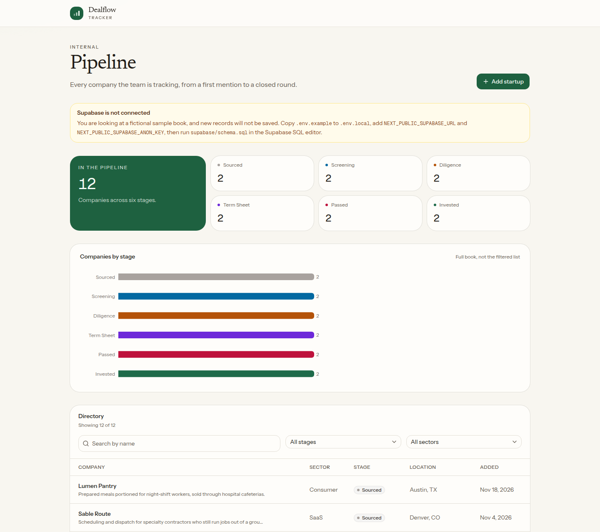

# Dealflow Tracker

A lightweight internal tool for a venture team. It tracks startups through a fixed pipeline: Sourced, Screening, Diligence, Term Sheet, Passed, and Invested. Each company can carry meeting notes, and a server-side route can draft a three-bullet investment brief.

This is a portfolio demo. The sample companies are fictional.

## Stack

- Next.js 16 (App Router) and TypeScript
- Tailwind CSS and shadcn/ui
- Supabase Postgres via `@supabase/supabase-js`
- Anthropic API via `@anthropic-ai/sdk`, called only from `app/api/summarise`
- Deploy target: Vercel

## Schema

Two tables, defined in `supabase/schema.sql`.

- `startups` is one row per company. `stage` is a check constraint on the six pipeline values, with default `Sourced`, so the database and the badges cannot drift.
- `notes` is many rows per startup (`startup_id` references `startups.id` on delete cascade). Notes stay out of the company row so a record can accumulate calls without getting wider.
- `startups_stage_idx` supports the dashboard counts. `notes_startup_id_idx` supports the company page.

There is no authentication. The app uses the Supabase anon key. Row Level Security is enabled, with permissive `select`, `insert`, and `update` policies for `anon` and `authenticated`, and no delete policy. That is a deliberate demo trade-off so the project runs after you paste the SQL. It is not appropriate for real founder data: anyone with the anon key can read and write both tables.

`supabase/seed.sql` loads 12 fictional companies across consumer, fintech, SaaS, and deep tech, spread over all six stages, plus two or three notes on several of them. It is safe to re-run.

## What I would build next

- Auth with Supabase Auth, and RLS policies scoped to the signed-in team instead of the anon key.
- CSV import for a partner's existing tracker.
- An LP-facing read-only view that hides notes and passed companies.
- Email digests of what moved stage during the week.
