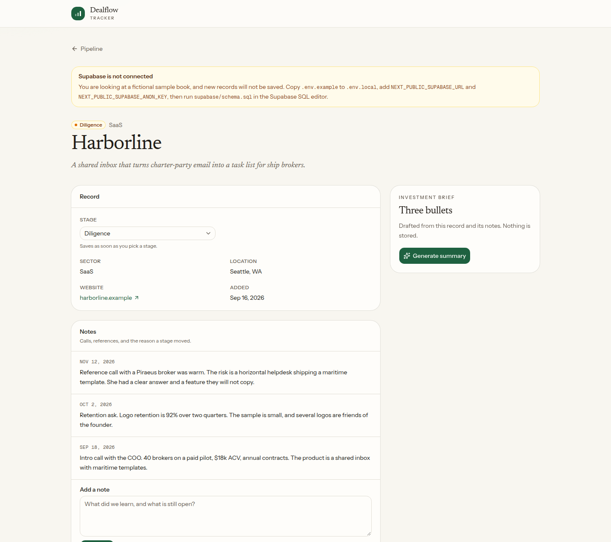

# Dealflow Tracker

A lightweight internal tool for a venture team. It tracks startups through a fixed pipeline: Sourced, Screening, Diligence, Term Sheet, Passed, and Invested. Each company can carry meeting notes, and a server-side route can draft a three-bullet investment brief.

This is a portfolio demo. The sample companies are fictional.




## Stack

- Next.js 16 (App Router) and TypeScript
- Tailwind CSS and shadcn/ui
- Supabase Postgres via `@supabase/supabase-js`
- Anthropic API via `@anthropic-ai/sdk`, called only from `app/api/summarise`
- Deploy target: Vercel

## Schema

Two tables, defined in `supabase/schema.sql`.

- `startups` is one row per company. `stage` is a check constraint on the six pipeline values, with default `Sourced`, so the database and the badges cannot drift.
- `notes` is many rows per startup (`startup_id` references `startups.id` on delete cascade). Notes stay out of the company row so a record can accumulate calls without getting wider.
- `startups_stage_idx` supports the dashboard counts. `notes_startup_id_idx` supports the company page.

There is no authentication. The app uses the Supabase anon key. Row Level Security is enabled, with permissive `select`, `insert`, and `update` policies for `anon` and `authenticated`, and no delete policy. That is a deliberate demo trade-off so the project runs after you paste the SQL. It is not appropriate for real founder data: anyone with the anon key can read and write both tables.

`supabase/seed.sql` loads 12 fictional companies across consumer, fintech, SaaS, and deep tech, spread over all six stages, plus two or three notes on several of them. It is safe to re-run.

## Run locally

```bash
npm install
cp .env.example .env.local
npm run dev
```

Open [http://localhost:3000](http://localhost:3000).

If `NEXT_PUBLIC_SUPABASE_URL` or `NEXT_PUBLIC_SUPABASE_ANON_KEY` is missing, the app does not crash. It shows a setup banner and a fictional sample book. Adds, stage changes, and notes are refused until Supabase is connected.

To use a real database:

1. Create a Supabase project.
2. In the SQL editor, run `supabase/schema.sql`, then `supabase/seed.sql`.
3. In Project Settings → API, copy the project URL and the anon public key into `.env.local`.
4. Restart `npm run dev`.

The summary button needs `ANTHROPIC_API_KEY` in `.env.local`. Without it, the button returns a clear error and the rest of the tracker still works. `ANTHROPIC_MODEL` is optional and defaults to `claude-sonnet-5-5`.

Pipeline pages export `dynamic = "force-dynamic"`, so `npm run build` does not query the database and succeeds before any rows exist.

## Deploy to Vercel

1. Create a Supabase project and run `supabase/schema.sql`, then `supabase/seed.sql`, in the SQL editor.
2. Push this repository to GitHub.
3. In Vercel, import the repository. Framework preset: Next.js. Leave the build command as `npm run build`.
4. Before the first deploy, add these environment variables on the Vercel project:

   | Name | Required | Notes |
   | --- | --- | --- |
   | `NEXT_PUBLIC_SUPABASE_URL` | Yes | Supabase project URL |
   | `NEXT_PUBLIC_SUPABASE_ANON_KEY` | Yes | Supabase anon public key |
   | `ANTHROPIC_API_KEY` | For summaries | Server-only. Do not prefix it with `NEXT_PUBLIC_` |
   | `ANTHROPIC_MODEL` | No | Defaults to `claude-sonnet-5-5` |

5. Deploy. If you add or change a variable later, redeploy so the new value is picked up.
6. Open the deployment. The pipeline should list the seeded companies. Open one, change its stage, add a note, and generate a summary.

The deployment is public. There is no login.

## What I would build next

- Auth with Supabase Auth, and RLS policies scoped to the signed-in team instead of the anon key.
- CSV import for a partner's existing tracker.
- An LP-facing read-only view that hides notes and passed companies.
- Email digests of what moved stage during the week.
